# Agentic VS Code Rebuild Skill

A Cline-compatible skill package that drives a secure, evidence-based rebuild of a VS Code extension.
Workflow: INSPECT -> DIAGNOSE -> PLAN -> APPROVE -> IMPLEMENT -> TEST -> PACKAGE -> VERIFY.

## Architecture

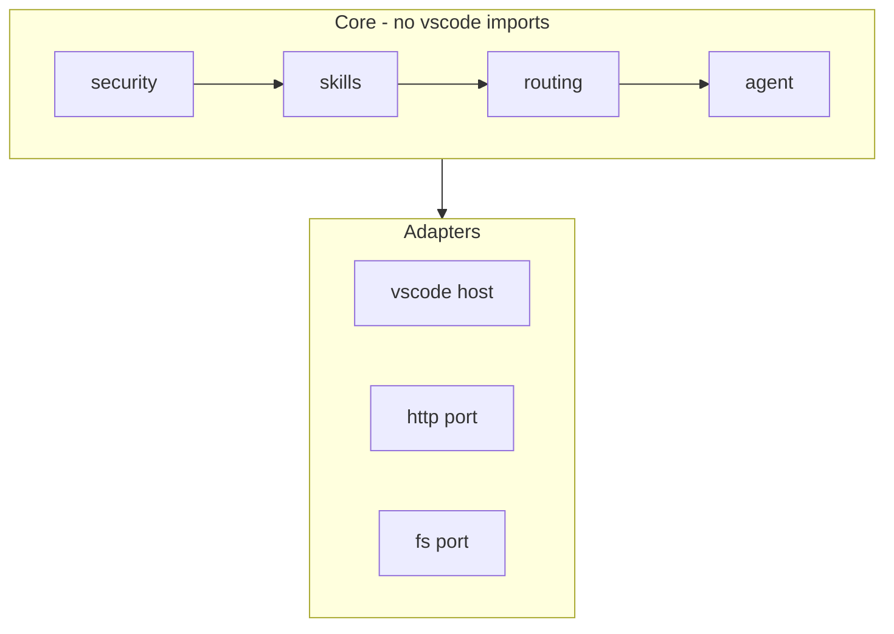

## Rebuild Workflow

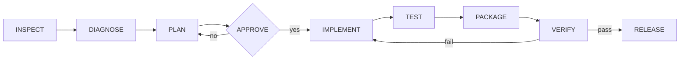

## Skill Activation Stages

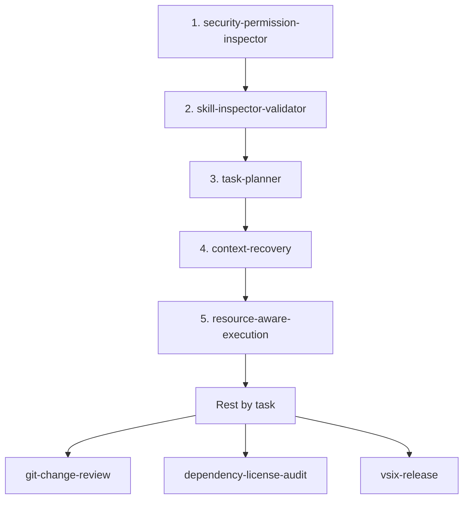

Red nodes are review/release gates - never auto-activate alongside an in-progress edit.

## Provider Routing

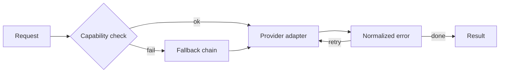


## Bundled Skills (14)

Each skill is an instruction bundle that runs inside the permission engine and grants no permissions.

### 1. security-permission-inspector

Audits a proposed action, skill, or dependency for security impact and explains it in plain language before approval.

- needs: read, network:docs
- risk: low

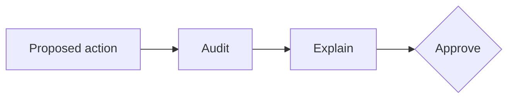

### 2. skill-inspector-validator

Validates a candidate skill's metadata and scans its content for dangerous patterns before installation.

- needs: read
- risk: low

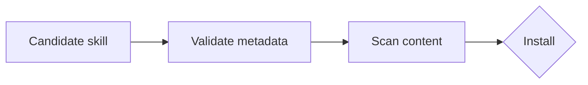

### 3. task-planner

Decomposes a user request into verifiable steps with acceptance criteria and a checkpoint plan.

- needs: read
- risk: low


### 4. context-recovery

Rebuilds working state from plan.md/progress.md/structure.md, git state, and open errors after an interruption or provider switch.

- needs: read, git
- risk: low

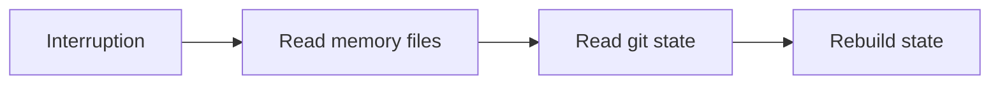

### 5. structure-analyzer

Maps the repository layout, entry points, and build/test commands into structure.md.

- needs: read
- risk: low


### 6. codebase-explorer

Answers "where is X" questions with targeted searches instead of dumping files.

- needs: read
- risk: low


### 7. error-diagnoser

Diagnoses build/test/runtime failures; produces a reproduction before a fix.

- needs: read, exec:test
- risk: medium

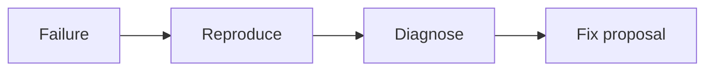

### 8. test-verifier

Runs the project's test/lint/typecheck commands and reports evidence-backed results.

- needs: exec:test
- risk: medium

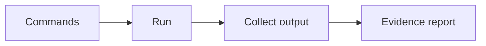

### 9. git-change-review

Reviews the diff for scope creep, accidental deletions, secrets, and untested paths. Review gate.

- needs: read, git
- risk: medium

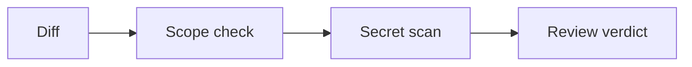

### 10. docs-maintainer

Updates README/CHANGELOG/context files to match actual behavior.

- needs: read, write:docs
- risk: medium

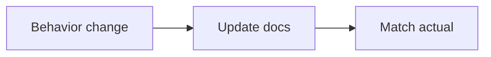

### 11. dependency-license-audit

Checks new/updated dependencies for license compatibility, size, maintenance, and postinstall risk. Review gate.

- needs: read, network:registries
- risk: medium

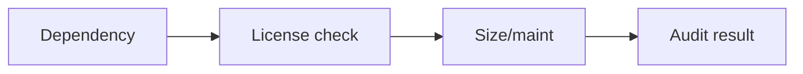

### 12. vsix-release

Runs compile/lint/test, packages, inspects the archive, and documents install/upgrade verification. Release gate.

- needs: exec:build, write:dist
- risk: high

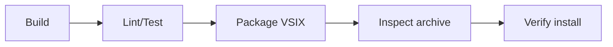

### 13. provider-capability-assessor

Determines which provider/model can serve a task given detected capabilities, cost, and context needs.

- needs: read, network:provider
- risk: low

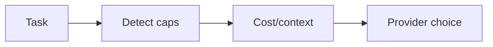

### 14. resource-aware-execution

Chooses the cheapest correct execution strategy given the system assessment and remaining budget.

- needs: read
- risk: low

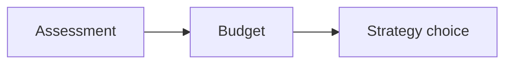

## Install the skill

```bash
mkdir -p <repo>/.cline/skills
cp -r .cline/skills/agentic-vscode-rebuild <repo>/.cline/skills/
```

Then in VS Code: Settings -> Features -> Enable Skills.

## Validate

```bash
python tools/validate_skill.py   # exit 0 = OK
```

## Multi-agent support

This repo ships instruction files for multiple coding agents:

| Agent | File |
|---|---|
| Claude Code | CLAUDE.md |
| Codex / OpenCode | AGENTS.md |

All agents follow the same workflow and non-negotiables defined above.

## License

MIT.
